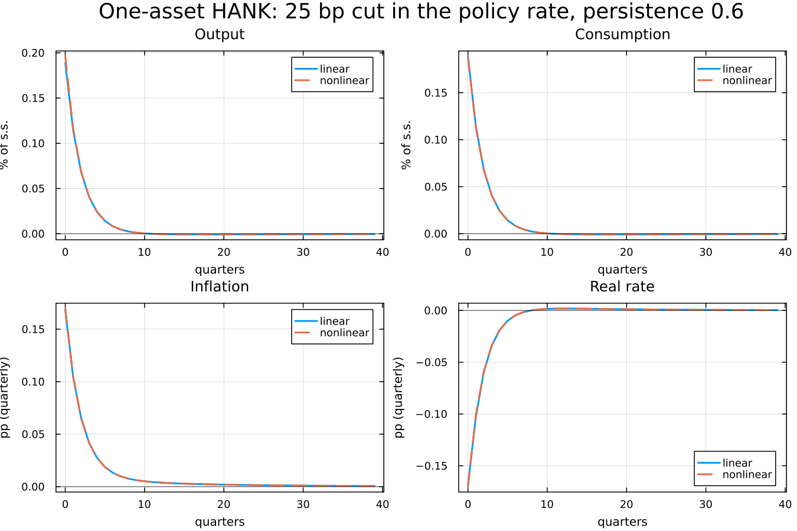
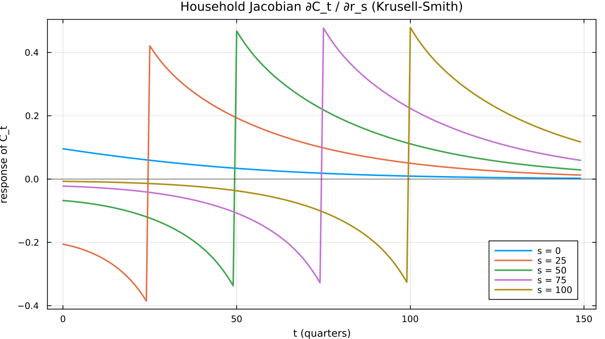
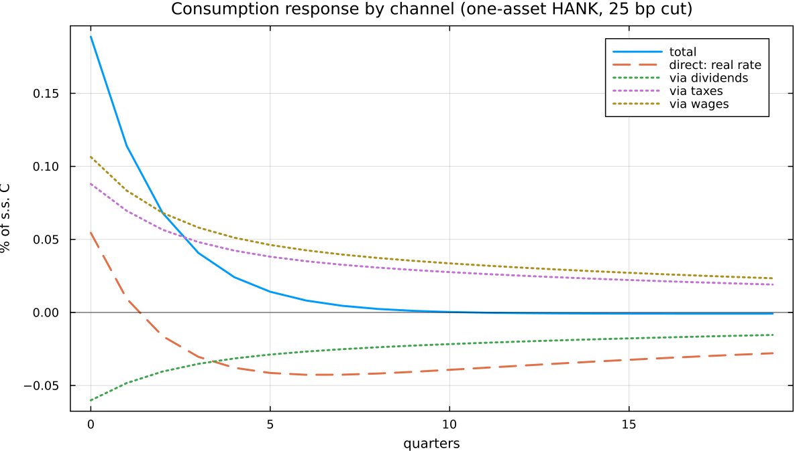
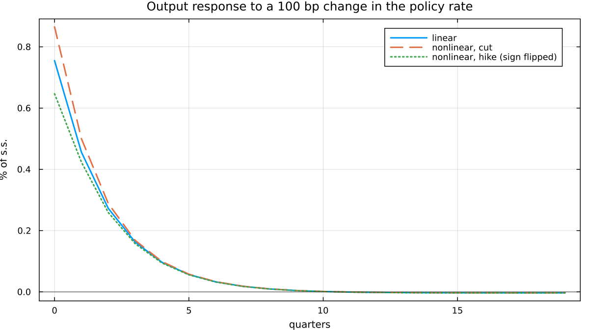
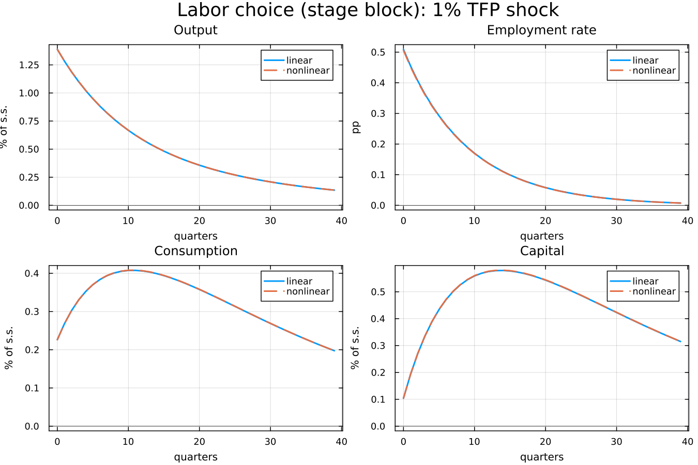

# SequenceJacobian.jl

A Julia port of **[sequence-jacobian](https://github.com/shade-econ/sequence-jacobian)**,
the Python toolbox of **Adrien Auclert, Bence Bardóczy, Matthew Rognlie and Ludwig
Straub** for solving and estimating heterogeneous-agent models in the sequence space.

> The method, the toolbox design and the example models are the work of Auclert,
> Bardóczy, Rognlie and Straub. This package translates their code into Julia. If you use
> it, please cite their paper:
>
> Auclert, Adrien, Bence Bardóczy, Matthew Rognlie, and Ludwig Straub. 2021. "Using the
> Sequence-Space Jacobian to Solve and Estimate Heterogeneous-Agent Models."
> *Econometrica* 89 (5): 2375–2408. <https://doi.org/10.3982/ECTA17434>

The interface follows the Python toolbox function by function: a model written for
`sequence-jacobian` translates line by line. On the toolbox's own example models (RBC,
Krusell-Smith, one-asset HANK, two-asset HANK) the port reproduces Python's steady
states, Jacobians and transitions to 1e-9 or better (see [CHANGELOG.md](CHANGELOG.md)).

## How it works

**The problem.** In a heterogeneous-agent model, millions of households differ in income
and wealth, and aggregate variables (output, prices, interest rates) depend on how all of
them respond. Solving such models used to mean simulating the whole distribution of
households forward for every guess of every aggregate path, which is slow.

**The sequence-space idea.** Auclert, Bardóczy, Rognlie and Straub look at the model as a
map from *paths* of aggregate variables to *paths* of other aggregate variables. Around
the steady state, this map is linear and is fully described by its Jacobians: matrices
whose entry `(t, s)` says how much a variable at date `t` moves when an input moves at
date `s`.

**Blocks.** A model is written as a few blocks connected by the names of their
variables: households, firms, a central bank, market clearing. Each block maps input
paths into output paths. The toolbox works out the order of the blocks (a directed
acyclic graph) and composes their Jacobians by the chain rule.

**The fake-news algorithm.** The Jacobian of the household block is the expensive part.
The fake-news algorithm obtains it from a single backward pass of the household problem
per input, instead of one full simulation per date. A household Jacobian with 300 dates
then takes about as long as solving the household problem a few times.

**General equilibrium.** Equilibrium means that some *targets* (market clearing, Euler
equations, Phillips curves) are zero at every date, solved for some *unknowns* (prices,
quantities), given the paths of *exogenous* shocks. With the Jacobians `H_U` and `H_Z` of
the targets with respect to the unknowns and the shocks, the response of the unknowns is
`dU = -H_U⁻¹ H_Z dZ`. The same Jacobians are the starting point for nonlinear
perfect-foresight transitions (solved by a quasi-Newton method) and for estimation (the
impulse responses are the model's moving-average representation).

## What it does

* **Blocks.** Write a model as a directed acyclic graph of blocks:
  * `simple` blocks from plain Julia functions, with `X(-1)` and `X(+1)` for lags and leads;
  * `het` blocks for heterogeneous agents, from a backward-iteration function, with
    hetinputs and hetoutputs;
  * `StageBlock`s for heterogeneous agents whose period is a sequence of stages:
    exogenous shocks, discrete choices with taste shocks, continuous choices in one or
    two dimensions;
  * `solved` blocks that solve a set of equations internally;
  * `create_model` / `combine` to assemble them; `remap` and `rename` to reuse them.
* **Steady states**: `steady_state` (evaluate) and `solve_steady_state` (solve for
  unknowns given targets), with univariate (Brent, bisection, ...) and multivariate
  (Broyden, Newton, NLsolve) solvers, bounds, and per-block options.
* **Sequence-space Jacobians**: `jacobian` (the fake-news algorithm for
  heterogeneous-agent blocks, automatic differentiation of simple blocks),
  `solve_jacobian` (general equilibrium), sparse lead/lag operators, `JacobianDict`
  algebra.
* **Impulse responses**: `impulse_linear` / `solve_impulse_linear` (first order),
  `impulse_nonlinear` / `solve_impulse_nonlinear` (perfect-foresight transitions, with
  heterogeneous agents, a backtracking quasi-Newton solver and an optional linear warm
  start). Distribution and policy paths are available on request.
* **Estimation**: covariances from impulse responses by FFT (`all_covariances`) and the
  Gaussian log likelihood of observed data (`log_likelihood`).
* **Validation and household statistics** (not in the Python toolbox; they follow checks
  in Yuxuan Zhao's sequence-space notebooks): fake-news against brute-force Jacobians,
  steady-path and terminal-distribution checks, the decomposition of a household
  response into its channels, marginal propensities to consume.
* **Test models**: the four Python example models, a two-type Krusell-Smith model, and a
  labor-choice model built from stages.

### Beyond the Python toolbox

New in this port:

* Markov transitions in stage blocks that differ by another state
  (`ExogenousMaker(...; by = j)`) or move two states jointly (`joint = true`);
* two-sided differencing of the whole household block (`twosided = true`), which makes
  household Jacobians markedly more accurate;
* stage-block Jacobians and transitions that need about ten times less memory;
* a working Jacobian for stage blocks with a two-dimensional continuous choice, which
  fails in Python 1.0.0.

Following Yuxuan Zhao's sequence-space notebooks: a nonlinear solver that backtracks and
can start from the linear solution, and the validation and household-statistics tools
above. See [CHANGELOG.md](CHANGELOG.md) for details.

## Installation

Julia 1.9 or later.

```julia
using Pkg
Pkg.add(url="https://github.com/smaghakyan/SequenceJacobian.jl")
```

or, from a clone of this repository,

```julia
using Pkg
Pkg.activate("path/to/SequenceJacobian.jl")
Pkg.instantiate()
```

Then `using SequenceJacobian`. Dependencies: Distributions, FFTW, NLsolve,
OrderedCollections, Roots (and the standard libraries LinearAlgebra, Printf, Statistics).

## Quick start

```julia
using SequenceJacobian

# The one-asset HANK example model and its steady state
model_ss, ss, model, unknowns, targets, exogenous = hank_dag()

# General-equilibrium Jacobians: G[output][shock] is a T x T matrix
T  = 300
G  = solve_jacobian(model, ss, unknowns, targets, exogenous; T=T)

# Response of output to a 25 basis point cut in the policy rate
dr = -0.0025 .* 0.6 .^ (0:T-1)
dY = G["Y"]["rstar"] * dr

# The same response, nonlinear
nl = solve_impulse_nonlinear(model, ss, unknowns, targets, Dict("rstar" => dr))
nl["Y"]
```

Writing your own model:

```julia
using SequenceJacobian

function firm(; K, L, Z, alpha, delta)
    r = alpha * Z * (K(-1) / L)^(alpha - 1) - delta
    w = (1 - alpha) * Z * (K(-1) / L)^alpha
    Y = Z * K(-1)^alpha * L^(1 - alpha)
    return (r=r, w=w, Y=Y)
end

function mkt_clearing(; K, A, Y, C, delta)
    asset_mkt = A - K
    goods_mkt = Y - C - (K - (1 - delta) * K(-1))
    return (asset_mkt=asset_mkt, goods_mkt=goods_mkt)
end

household = add_hetinputs(hh_sim, [income, make_grids])   # the standard incomplete-markets household
model = create_model([household, simple(firm), simple(mkt_clearing)]; name="Krusell-Smith")
```

See [`examples/08_build_your_own_model.jl`](examples/08_build_your_own_model.jl) for the
whole model, including your own household block.

## Examples

Run any of them from the repository root with `julia --project=. examples/<file>`.

| Script | Content |
|---|---|
| [`01_rbc.jl`](examples/01_rbc.jl) | RBC: steady state, GE Jacobians, linear and nonlinear responses, the DAG |
| [`02_krusell_smith.jl`](examples/02_krusell_smith.jl) | Krusell-Smith: household Jacobians, GE, distribution paths, two household types |
| [`03_one_asset_hank.jl`](examples/03_one_asset_hank.jl) | One-asset HANK with endogenous labor: monetary policy shock |
| [`04_two_asset_hank.jl`](examples/04_two_asset_hank.jl) | Two-asset HANK: two endogenous states, solved blocks, two-sided Jacobians |
| [`05_labor_choice_stage_block.jl`](examples/05_labor_choice_stage_block.jl) | A household built from stages: shock, logit labor choice, consumption-saving |
| [`06_validation_and_household_statistics.jl`](examples/06_validation_and_household_statistics.jl) | Fake-news check, steady-path check, channel decomposition, MPCs |
| [`07_estimation.jl`](examples/07_estimation.jl) | Covariances and likelihood from impulse responses |
| [`08_build_your_own_model.jl`](examples/08_build_your_own_model.jl) | Writing simple blocks, a household block, hetinputs and hetoutputs |

## Results

The figures below come from the toolbox's test models, run by
[`showcase/run_showcase.jl`](showcase/run_showcase.jl). The full page, with tables of
speed and accuracy checks, is [`showcase/RESULTS.md`](showcase/RESULTS.md).

**Monetary policy in a HANK model.** The response of the one-asset HANK model to a
25 basis point cut in the policy rate that fades out with persistence 0.6. Solid lines
are the first-order solution from the sequence-space Jacobians; dashed lines are the
exact nonlinear perfect-foresight solution. Output, consumption and inflation rise and the
real rate falls. For a shock of this size the two solutions are close.



**What the household Jacobian looks like.** Each line is one column of the Jacobian
∂C<sub>t</sub>/∂r<sub>s</sub> in the Krusell-Smith model: the response of aggregate
consumption at every date `t` to news that the interest rate will be higher at a single
date `s`. Consumption starts to react before the change, as households anticipate it,
moves most when the higher return is paid, and then returns slowly to its steady state.
The fake-news algorithm computes all 300 columns from one backward pass.



**Why the consumption response happens.** `channel_decomposition` splits the
consumption response to the rate cut into the part due directly to the real interest
rate and the parts that come through wages, dividends and taxes, which move because of
general equilibrium. In this model the real rate itself accounts for about 29% of the
impact response; the rest comes through the indirect channels, the central finding of
the HANK literature on monetary transmission.



**When the linear solution is not enough.** Responses of output to a 100 basis point cut
and to a 100 basis point hike (shown with the sign flipped). In the linear solution the
two are mirror images. In the nonlinear solution the cut raises output by 0.87% on
impact while the hike lowers it by only 0.65%, against 0.75% in the linear solution.



**A discrete choice: who works.** A household problem written as a `StageBlock`, with
three stages each period: a productivity shock, a choice between working and staying home
(with taste shocks), and a consumption-saving decision. After a TFP shock, the response of
the employment rate comes from households changing that choice.



The results page also has the RBC and Krusell-Smith responses, the wealth distribution
(Lorenz curve), marginal propensities to consume by wealth and income, and the two-asset
HANK model.

## Documentation

* [`docs/guide.md`](docs/guide.md): how the toolbox works and how to use every part of it.
* [`docs/api.md`](docs/api.md): reference for every exported function and type.
* [`docs/python_to_julia.md`](docs/python_to_julia.md): translating a Python
  `sequence-jacobian` model.
* The original toolbox's notebooks and the
  [NBER heterogeneous-agent workshop materials](https://github.com/shade-econ) explain
  the methods; the code in them translates directly.

## Tests

```julia
using Pkg
Pkg.activate("path/to/SequenceJacobian.jl")
Pkg.test()
```

The tests compare the example models with reference numbers from Python
`sequence-jacobian` 1.0.0 and check the stage-block model for internal consistency.

## Status

The first call of each function in a Julia session compiles it; later calls are fast.
Interpolation helpers handle arrays with up to three dimensions.

## Citation and acknowledgements

Please cite Auclert, Bardóczy, Rognlie and Straub (2021) when you use this package;
[`CITATION.cff`](CITATION.cff) has the entry. Parts of the source started from
[SSJ.jl](https://github.com/FRBNY-DSGE/SSJ.jl) by the Federal Reserve Bank of New York
DSGE team, and the validation tools follow checks in Yuxuan Zhao's sequence-space
notebooks. See [`NOTICE.md`](NOTICE.md).

Julia port by Sargis Maghakyan. Questions and bug reports are welcome as GitHub issues;
problems with the port should not be sent to the authors of the Python toolbox.

## License

MIT, as the Python toolbox. The five files that started from SSJ.jl are also under its
BSD 3-clause license. See [`LICENSE`](LICENSE) and [`NOTICE.md`](NOTICE.md).
