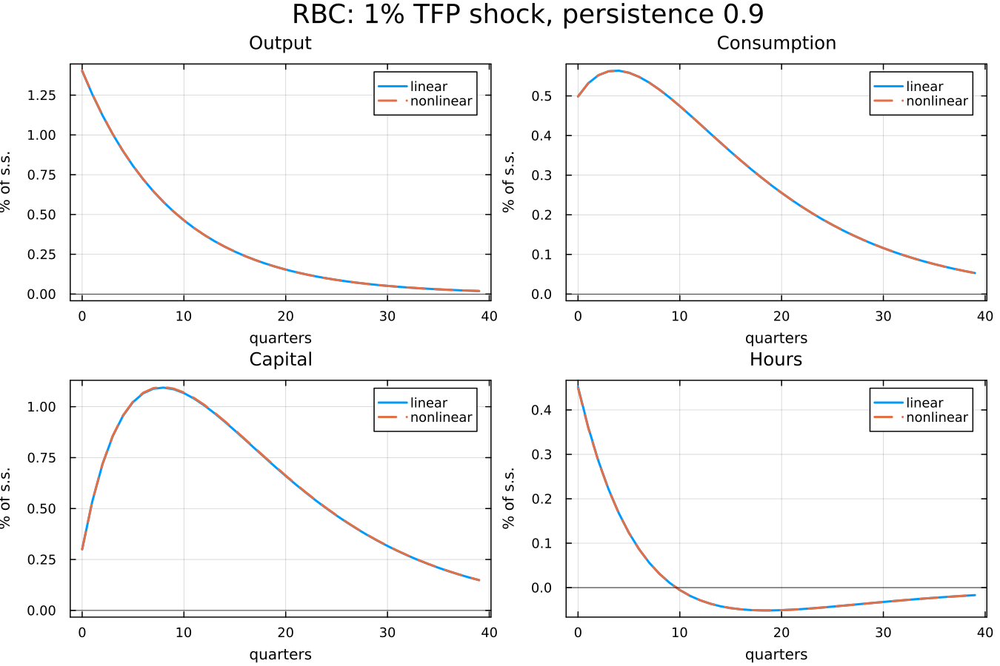
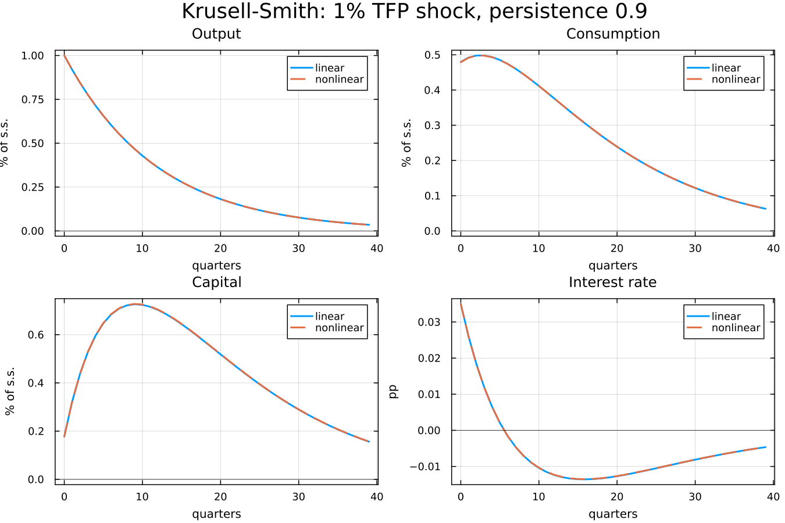
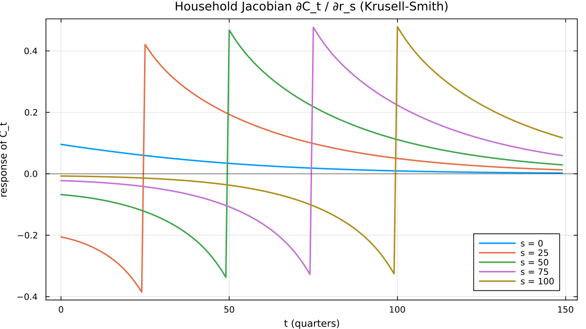
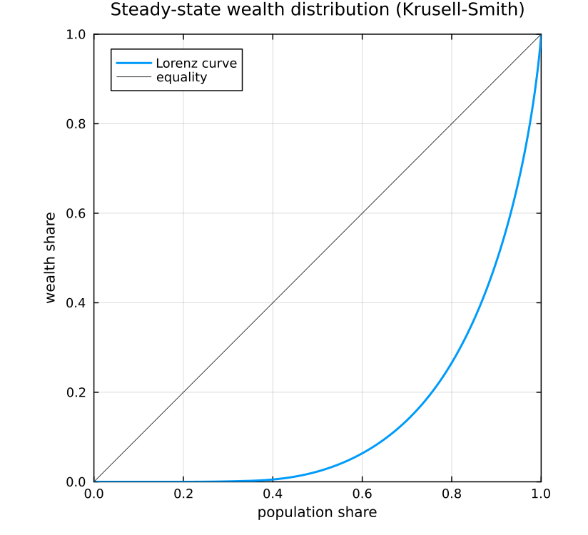
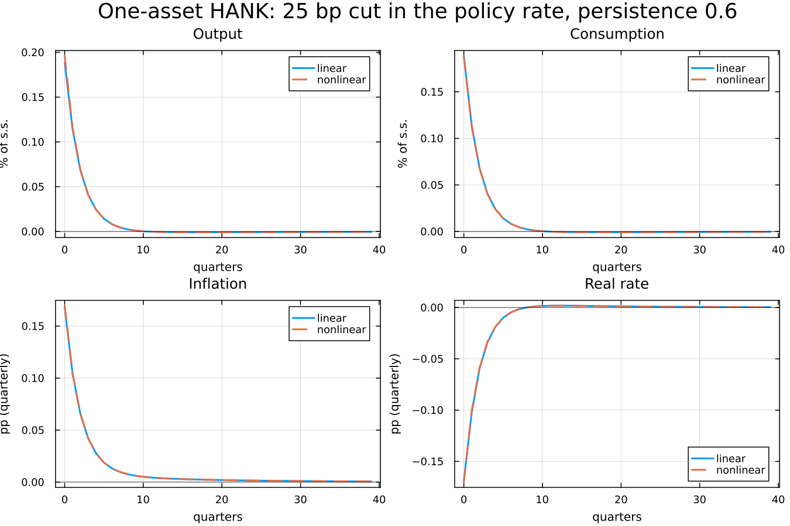
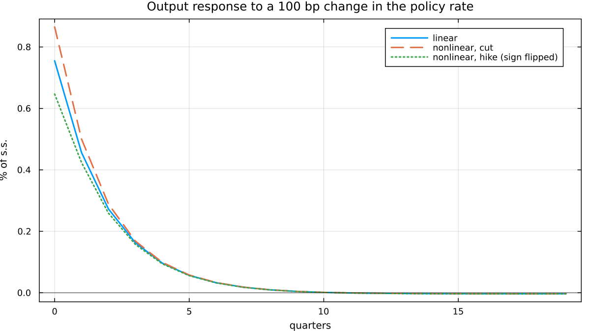
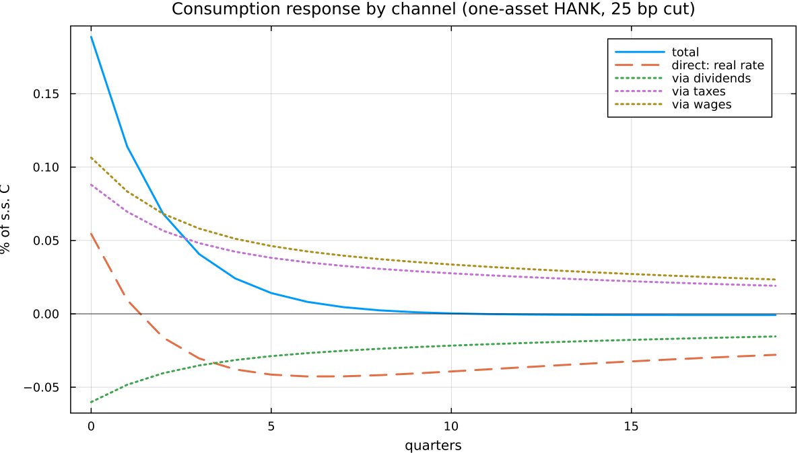
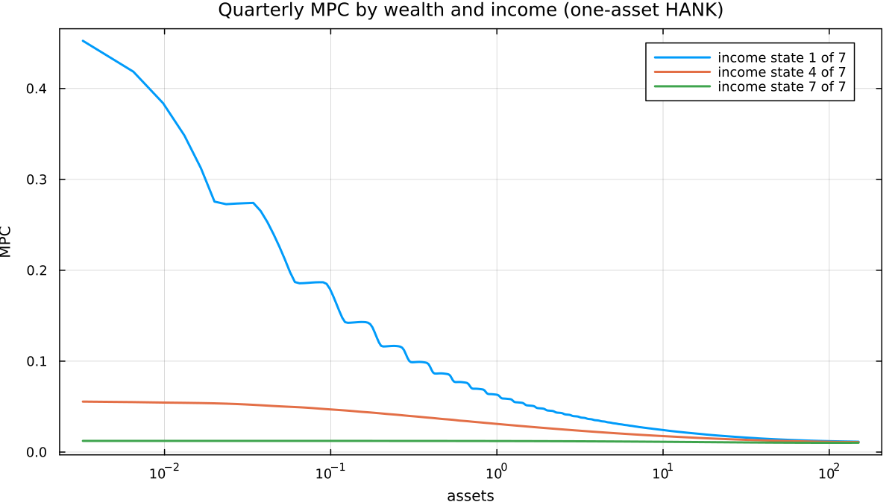
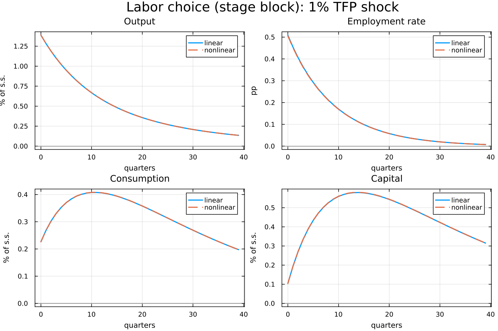
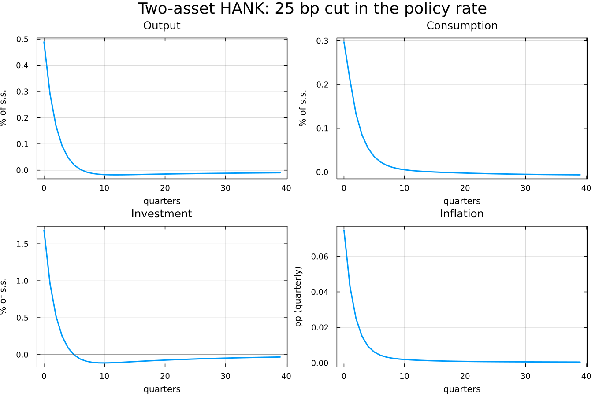

# Results

Produced by [`showcase/run_showcase.jl`](run_showcase.jl) with SequenceJacobian.jl 0.3.0 on Julia 1.12.2. The models are the toolbox's test models (`src/examples/`); Krusell-Smith and one-asset HANK use the finer grids of the Python toolbox's notebooks. Horizon T = 300 quarters.

## Speed

Seconds after compilation, on AMD Ryzen 5 5500U with Radeon Graphics. *Steady state* includes building the model; *GE Jacobian* is `solve_jacobian` with T = 300; *nonlinear* is `solve_impulse_nonlinear` for the shocks in the figures below.

| Model | Household grid | Steady state | GE Jacobian | Nonlinear transition |
|---|---|---|---|---|
| RBC | — | 0.11 s | 0.13 s | 0.36 s |
| Krusell-Smith | 7 × 500 | 5.7 s | 1.1 s | 5.0 s |
| One-asset HANK | 7 × 500 | 10.3 s | 4.5 s | 8.7 s |
| Labor choice (stage block) | 2 × 5 × 100 | 13.7 s | 1.5 s | 5.1 s |
| Two-asset HANK | 3 × 50 × 70 | 208.4 s | 69.0 s | — |

## Accuracy checks

* *Steady-state residual*: largest equilibrium condition at the steady state.
* *Steady path*: largest equilibrium condition when the steady state is fed through the nonlinear transition (`steady_path_error`).
* *Fake news vs brute force*: largest difference between the household Jacobian from the fake-news algorithm and one from nonlinear transitions, relative to the largest entry (`fake_news_error`, T = 10).
* *Terminal distance*: largest deviation of the distribution from its steady state after the last date of the nonlinear transition.

| Model | Steady-state residual | Steady path | Fake news vs brute force | Terminal distance |
|---|---|---|---|---|
| RBC | 6.7e-16 | 0.0e+00 | — | — |
| Krusell-Smith | 5.3e-13 | 4.3e-08 | 7.7e-07 | 3.9e-09 |
| One-asset HANK | 5.4e-09 | 8.1e-08 | 4.9e-07 | 5.5e-09 |
| Labor choice (stage block) | 6.9e-13 | 2.9e-06 | 2.7e-07 | — |
| Two-asset HANK | 1.6e-10 | — | — | — |

## How to read the figures

All shocks are unexpected at date 0 and fade out geometrically. Responses are deviations from the steady state: quantities in percent of their steady-state value, rates in percentage points per quarter. Solid lines are the first-order (linear) solution computed from the sequence-space Jacobians; dashed lines are the exact nonlinear perfect-foresight solution of the same model. Where the two coincide, the linear solution is accurate for that shock.

## RBC

The representative-agent benchmark: a 1% increase in total factor productivity that fades with persistence 0.9. There is no household heterogeneity, so this model solves in milliseconds and is the reference point for the models below.

## Krusell-Smith

The same productivity shock in an economy where households face uninsurable income risk and a borrowing limit (7 income states, 500 asset grid points). Aggregate saving now comes from the whole distribution of households.

Columns of the household Jacobian of consumption with respect to the interest rate: an expected change in r at date s moves consumption before s (anticipation) and after it.

The Lorenz curve plots the share of total wealth held by the poorest x% of households. The further it bows below the 45-degree line, the more unequal the distribution.
Steady-state wealth: Gini 0.718, top 10% share 0.507, share at the borrowing limit 0.211.

## One-asset HANK

A New Keynesian model with heterogeneous households who choose how much to work and save, sticky prices, a Taylor rule and a government that adjusts taxes. The shock is a 25 basis point cut in the policy rate that fades with persistence 0.6.

Linear and nonlinear responses to a 100 basis point change in the policy rate. The hike is shown with its sign flipped, so that in a linear model the three lines would coincide; the gaps measure the nonlinearity.
On impact, output rises by 0.87% after the cut and falls by 0.65% after the hike; the linear solution gives 0.75%.

Channels of the consumption response (`channel_decomposition`). Households respond to the real interest rate directly, and indirectly to the changes in wages, dividends and taxes that the rate cut causes in general equilibrium. The lines add up to the total.
On impact, the direct effect of the real rate accounts for 29% of the total.

Marginal propensities to consume out of a one-time transfer of 3% of mean quarterly labor income (`mpc_statistics`):

| Horizon | Mean | Median | 90th percentile | Share with MPC ≥ 0.5 | Mean, constrained households |
|---|---|---|---|---|---|
| 1 quarter | 0.094 | 0.024 | 0.353 | 0.000 | 0.398 |
| 4 quarters | 0.184 | 0.094 | 0.527 | 0.189 | 0.531 |

Share of households at the borrowing constraint: 0.173.

The quarterly MPC across the wealth distribution for the lowest, middle and highest income state. Households with little wealth spend a large part of a transfer at once; the MPC falls as wealth rises.

## Labor choice (stage block)

Households receive a productivity shock, choose whether to work (logit, with taste shocks), then consume and save. The household is written as a `StageBlock` (`src/examples/LaborChoice.jl`).

## Two-asset HANK

Households hold a liquid asset and an illiquid asset that is costly to adjust, so many of them are wealthy but hand-to-mouth. Firms invest with adjustment costs; prices and wages are sticky. Response to a 25 basis point cut in the policy rate, first-order solution.

